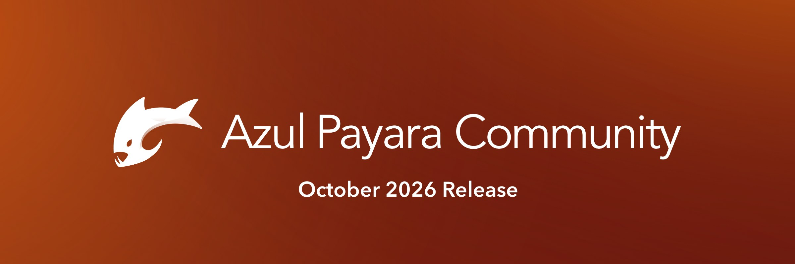

The October 2026 release brings Payara Community 7.2026.10, as well as Azul Payara Server & Micro 7.5.0, 6.43.0, 5.92.0 & 4.1.2.191.60.

The headline for Payara Community is day-to-day operations. SSH nodes no longer require elevated permissions, two new commands, delete-jvm-option and delete-system-properties, make configuration easier to manage from the command line, and a run of fixes resolves problems that show up in real deployments, from applications failing to deploy after a domain restart to concurrent deployments failing. Three of the changes in this release were contributed by the community (thank you!).

For Azul Payara, the main reason to upgrade is security. Three security fixes ship across all branches, from a remote code execution vulnerability in Eclipse GlassFish, to cross-site scripting in the Admin Console. The release notes flag no breaking changes this cycle, and Jakarta EE 11 and MicroProfile 7.1 remain the baseline on the 7 line.

## **Branches at a Glance**

| **Release**                               | **Jakarta EE** | **MicroProfile** | **Notable this cycle**                                                                               |
| ----------------------------------------- | -------------- | ---------------- | ---------------------------------------------------------------------------------------------------- |
| Payara Community 7.2026.10                | 11             | 7.1              | SSH nodes without elevated permissions, delete-jvm-option, delete-system-properties, community fixes |
| Azul Payara Server and Micro 7.5.0        | 11             | 7.1              | Security fixes, CDI DevMode, SSH provider and Windows SSH support, EclipseLink 5.0.1                 |
| Azul Payara Server and Micro 6.43.0       | 10             | 7.1              | Security fixes, CDI DevMode, SSH provider and Windows SSH support, DCOM removed                      |
| Azul Payara Server and Micro 5.92.0       | 8              | 4.1              | Security fixes, SSH provider and Windows SSH support, DCOM removed                                   |
| Azul Payara Server and Micro 4.1.2.191.60 | —              | —                | Security fixes, concurrent deployment fix, Jackson 2.18.11                                           |

## **Three Security Fixes Patched Across Every Azul Payara Branch**

Three security items ship in Azul Payara Server and Micro 7.5.0, 6.43.0, 5.92.0, and 4.1.2.191.60:

  - **CVE-2026-2587 and CVE-2026-2586**, a remote code execution vulnerability in Eclipse GlassFish.

  - **Remote code execution in JSFTemplating.**

  - **Cross-site scripting (XSS) in the Admin Console that allows full control.**

Shipping the patch across the full supported lifecycle, not only the latest major release, is the practice long-running Azul customers rely on. Azul is a registered CVE Numbering Authority (CNA) under CISA and DHS oversight, with patches backported to every supported version on a published monthly schedule. There is no reason to delay upgrading based on the major-version line you run.

## **What’s New in Payara Community 7.2026.10**

Payara Community 7.2026.10 ([download here](https://www.azul.com/downloads/azul-payara-community-edition)) is the open-source distribution that tracks the Payara 7 development line, shipping Jakarta EE 11 and MicroProfile 7.1.

This month's release is about making Payara easier to run and administer, and a good part of it came from the community itself.

### **SSH Nodes No Longer Require Elevated Permissions**

Managing SSH nodes no longer requires elevated permissions. If you run a Payara domain across several hosts, this removes a common friction point: the account Payara uses on a remote node no longer needs more access than the work actually requires, which is easier to justify to a security team and simpler to set up.

### **Two New Administration Commands**

Two new asadmin commands round out configuration management:

  - **`delete-jvm-option`** removes a JVM option from the configuration.

  - **`delete-system-properties`** removes system properties.

Together they give scripted and automated setups a way to undo configuration changes from the command line.

### **Fixes Worth Knowing About**

  - **Fixed the `start-domain` admin-password recovery prompt.** The prompt broke because auth-realm-name was dropped from domain.xml when the file was rewritten.

  - **Fixed concurrent deployments failing.** SaxParserHandlerBundled was a stateful singleton, which caused deployments running at the same time to fail.

  - **Fixed applications that use the MicroProfile REST Client not deploying after a domain restart.** Contributed by community member lprimak.

  - **Added leak prevention for the JAX-RS client in WAR libraries.** Also contributed by lprimak.

  - **Fixed the Request Tracing Service still generating random UUIDs when turned off.**

  - **Fixed the `InitialContext` contact list including extra hostnames** for IIOP and CORBA.

  - **Removed a misleading Admin Console warning**, "command create-deployment-group was not replicated to that instance".

### **JNDI And Agentic AI Housekeeping**

The JNDI context now throws a NameNotFoundException when a name cannot be found, contributed by community member mkarg. The OSGi exports of the Agentic AI implementation have also been reviewed, following the Jakarta Agentic AI preview that arrived in August and was extended to Payara Micro and Embedded in September. EclipseLink's CollectionChangeRecord now logs exceptions, which makes persistence problems easier to diagnose, and the Payara resources descriptor DTDs move to the new versioning scheme.

### **Community Contributions**

Thanks to community contributors **lprimak**, for the REST Client deployment fix ([FISH-12192](https://github.com/payara/Payara/pull/7902)) and the JAX-RS client leak prevention ([FISH-13968](https://github.com/payara/Payara/pull/8275)), and **mkarg**, for the JNDI NameNotFoundException change ([FISH-14641](https://github.com/payara/Payara/pull/8415)).

Every fix in the Community release links to its pull request [in the release notes](https://docs.azul.com/payara-community/release-notes/release-notes-7.2026.10.html), if you want to read the change itself.

### **Component Upgrades**

EclipseLink moves to **5.0.1** and Mojarra to **4.1.16**. Elsewhere: Grizzly 5.0.3, HK2 4.0.3, ha-api 3.2.0, Soteria 4.0.2, Payara Security Connectors 4.1.0, Yasson 3.0.5, Jackson BOM 2.22.3, Woodstox 7.3.0, Nimbus JOSE+JWT 10.10, MicroProfile Config API 3.1.2, MicroProfile Health API 4.0.2, OpenTelemetry 1.66.0 with semantic conventions 1.44.0, Apache SSHD 2.20.0, JLine 4.4.6, SLF4J 2.0.20, BCEL 6.13.0, and Kotlin stdlib 2.4.20.

## **What’s New In Azul Payara Server and Micro**

All four Azul Payara branches carry the security fixes mentioned above. This section covers what else changes on each branch.

### **Azul Payara 7.5.0**

Azul Payara 7.5.0 ([request free trial here](https://www.azul.com/azul-payara-trial/)) is the fifth regular monthly release on the Payara 7 line since Server 7 and Micro 7 reached general availability in May. Server 7.5.0 is Jakarta EE 11 certified across Full Platform, Web Profile, and Core Profile; Micro 7.5.0 implements the Web Profile and Core Profile APIs.

### **CDI DevMode**

CDI DevMode is implemented on the 7 and 6 lines. It adds a development-time console that shows how CDI beans, injection points, interceptors and events are wired together in a running application, so wiring problems such as circular or unresolved dependencies are easier to find. It is for development only and is enabled with the payara.dev.console system property.

### **SSH Provider And Windows SSH Support**

The SSH provider and Windows SSH support are ported to Azul Payara 7, 6, and 5, alongside the new delete-jvm-option and delete-system-properties commands.

### **Administration, JNDI And Persistence**

delete-jvm-option and delete-system-properties arrive on the 7, 6, and 5 lines, along with the JNDI NameNotFoundException change, the EclipseLink logging improvement, and the Payara resources descriptor DTD update.

### **Bug Fixes**

  - Fixed concurrent deployments failing because of a stateful singleton (every branch, including Payara 4).

  - Fixed the REST Client deployment issue after a domain restart (7 and 6 lines) and added JAX-RS client leak prevention (7 line).

  - Fixed Request Tracing UUID generation, the IIOP InitialContext contact list, and the misleading Admin Console deployment group warning (7, 6, and 5 lines).

### **Component Upgrades**

EclipseLink 5.0.1, Mojarra 4.1.16, Soteria 4.0.2, Payara Security Connectors 4.1.0, Yasson 3.0.5, Grizzly 5.0.3, HK2 4.0.3, ha-api 3.2.0, Woodstox 7.3.0, Jackson BOM 2.22.3, Protobuf 4.36.2, gRPC 1.84.0, OpenTelemetry 1.66.0, MicroProfile Config API 3.1.2, MicroProfile Health API 4.0.2, Apache SSHD 2.20.0, JLine 4.4.6, SLF4J 2.0.20, Nimbus JOSE+JWT 10.10, BCEL 6.13.0, and Kotlin stdlib 2.4.20.

The full list is [in the release notes.](https://docs.azul.com/payara/release-notes/release-notes-7.5.0.html)

### **Azul Payara 6.43.0**

Azul Payara 6.43.0 continues the Jakarta EE 10 line for customers not yet on Payara 7, on MicroProfile 7.1. Alongside the security fixes, it picks up CDI DevMode, the SSH provider and Windows SSH support, the two new administration commands, and the fixes listed above. DCOM is removed from the 6 line.

**Component upgrades:** EclipseLink 4.0.9, JAXB Impl 4.0.9, Yasson 3.0.5, Jackson BOM 2.22.3, OpenTelemetry 1.66.0 with semantic conventions 1.44.0, Protobuf 4.36.2, gRPC 1.84.0, Aries SpiFly 1.3.8, ha-api 3.2.0, Apache Ant 1.10.18, Nimbus JOSE+JWT 10.10, BCEL 6.13.0, Kotlin stdlib 2.4.20, JLine 4.4.6, SLF4J 2.0.20, and stax2-api 4.3.1.

### **Azul Payara 5.92.0**

Azul Payara 5.92.0 retains the javax.\* namespace, Jakarta EE 8, and MicroProfile 4.1 for long-lived applications that have not migrated to the jakarta.\* namespace. It picks up the security fixes, the SSH provider and Windows SSH support, the administration commands, and the fixes listed above. DCOM is removed from the 5 line.

**Component upgrades:** Jackson BOM 2.22.3, Protobuf 4.36.2, gRPC 1.84.0, SnakeYAML 2.7, Javassist 3.33.0-GA, Project Reactor 3.8.7, Apache Ant 1.10.18, Aries SpiFly 1.3.8, Payara Security Connectors 2.10.0, genericra 2.1-20100913, JLine 3.30.17, Nimbus JOSE+JWT 10.10, BCEL 6.13.0, and stax2-api 4.3.1.

### **Azul Payara 4.1.2.191.60**

Azul Payara 4.1.2.191.60 receives the three security fixes and the concurrent deployment fix, with Jackson moving to 2.18.11.

## **Looking Ahead**

The Azul Payara product line spans the JDK (Azul Zulu and Azul Prime), the full application server (Azul Payara Server) and the cloud-native runtime (Azul Payara Micro), all from one vendor. The 7, 6, 5, and 4 lines continue to receive monthly security and bug-fix releases on the published schedule, with patches backported across every supported version.

If you are evaluating a move to Payara 7, the jakarta.\* namespace is stable between Jakarta EE 10 and 11, so existing Jakarta EE 10 applications deploy on Payara 7 by upgrading the runtime rather than rewriting the codebase. Migration assessments are available through your Azul account team.

## **Upgrading And Feedback**

We recommend upgrading to the latest release for your line, and strongly so given that security patches are available across every supported branch, from the 7 line down to Payara 4.

Full details, including the complete component upgrade lists and pull request links, are in the release notes:

  - [Payara Community 7.2026.10](https://docs.azul.com/payara-community/release-notes/release-notes-7.2026.10.html)

  - [Azul Payara Server and Micro 7.5.0](https://docs.azul.com/payara/release-notes/release-notes-7.5.0.html)

  - [Azul Payara Server and Micro 6.43.0](https://docs.azul.com/payara/version/6/release-notes/release-notes-6.43.0.html)

  - [Azul Payara Server and Micro 5.92.0](https://docs.azul.com/payara/version/5/release-notes/release-notes-5.92.0.html)

  - [Azul Payara Server and Micro 4.1.2.191.60](https://docs.azul.com/payara/version/4/release-notes/release-notes-4.1.2.191.60.html)

For upgrade instructions, [see the Payara documentation](https://docs.azul.com/payara/technical-documentation/payara-server-documentation/upgrade-guide/); to report issues, contribute fixes, or follow the Payara 7 roadmap, visit the [Payara GitHub repository](https://github.com/payara/Payara), and for commercial support, contact your [Azul account team.](https://www.azul.com/contact/)

Happy deploying!
